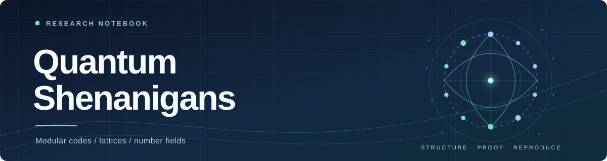
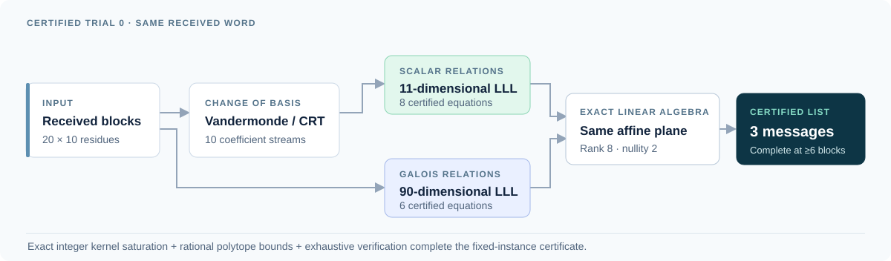

<p align="center">
  
</p>

<p align="center">
  <strong>Computational number theory, error-correcting codes, and proof-backed experiments.</strong>
</p>

<p align="center">
  <a href="#the-question">Overview</a> ·
  <a href="#a-certified-case-study">Results</a> ·
  <a href="#reproduce-the-result">Reproduce</a> ·
  <a href="#repository-guide">Explore</a>
</p>

---

## The question

Suppose a message is transmitted as residues modulo many primes, and some entire blocks are corrupted. Can we recover **every** message consistent with the surviving information—and prove that the returned list is complete?

This repository is a working research notebook on Chinese remainder (CRT) codes, cyclotomic number fields, lattice reduction, and exact integer reconstruction. It contains implementations, reproducible instances, formal arithmetic checks, and notes on what those checks do—and do not—establish.

The work is exploratory rather than a production decoding library.

## A certified case study

Our most thoroughly checked experiment uses 20 prime-modulus blocks over the ten-dimensional coefficient space associated with \(\mathbb{Q}(\zeta_{11})\). A received word mixes blocks from three different codewords. Each codeword agrees with only **6 of the 20 blocks**.

Two approaches independently recover the same solution set:

<p align="center">
  
</p>

| Fixed Trial-0 result | Certified outcome |
| :--- | :--- |
| Whole-block agreement threshold | At least **6 / 20** |
| Independent reference decoder | **Exactly 3** qualifying messages |
| Scalar affine interpolation | **8** height-certified equations; rank **8** |
| Galois-linear interpolation | Same rational affine solution space |
| Saturated integer kernel | Dimension **2** |
| Exact bounded extraction | **4** coordinate pairs considered; **3** admissible |
| Final comparison | **Identical 3-message lists** |

The 11-dimensional scalar construction suffices on this example; the additional Galois structure is **not necessary here**. The scalar interpolation lattice is also a specialization of published modular-reconstruction work, not a newly discovered lattice family.

**The distinction matters:** this is a complete, certified result for a **fixed received word**, not a general beyond-Johnson decoding theorem, a polynomial-time list-size guarantee, or evidence of universal runtime superiority.

The detailed claims, exact integer certificates, and independent references are collected in **[Established results and certificates](crt_codes/results/ESTABLISHED_RESULTS.md)**.

## Reproduce the result

Python **3.11** is the configuration used in the published CI runs. From the repository root:

```bash
python -m pip install "sympy==1.14.0" "pytest==9.2.0" "fpylll==0.6.4" "cysignals==1.12.5"
python -m pytest crt_codes/test_exhaustive.py crt_codes/test_integer_affine.py -q
python -m crt_codes.scalar_affine_trial0 --output scalar-affine-trial0.json
```

The last command reconstructs the **same fixed Trial-0 input** and compares scalar and Galois decoding, exact integer extraction, and an independent exhaustive reference. It produces an auditable JSON certificate. It is not a random benchmark or parameter sweep.

For the separate Galois Stage-B certificate, run:

```bash
python -m crt_codes.stage_b_certificate --output stage-b-certificate.json
```

See the **[reproduction guide](docs/REPRODUCING.md)** for environment notes, expected results, verification checkpoints, and preserved CI artifacts.

## Repository guide

| Where to look | What it contains |
| :--- | :--- |
| [`crt_codes/scalar_affine_trial0.py`](crt_codes/scalar_affine_trial0.py) | The smaller 11-dimensional scalar relation comparator |
| [`crt_codes/folded.py`](crt_codes/folded.py) | Cyclotomic code construction and Galois-linear decoding |
| [`crt_codes/integer_affine.py`](crt_codes/integer_affine.py) | Exact saturated integer kernels and bounded polytope enumeration |
| [`crt_codes/exhaustive.py`](crt_codes/exhaustive.py) | Independent complete CRT-subset reference decoder |
| [`crt_codes/results/`](crt_codes/results/) | Result records and the canonical claim ledger |
| [`crt_codes/notes/scalar-affine-duality-literature.md`](crt_codes/notes/scalar-affine-duality-literature.md) | Connection to Cohn–Heninger and interleaved CRT locator lattices |
| [`crt_codes/RESEARCH.md`](crt_codes/RESEARCH.md) | Historical research notebook; exploratory claims are not current theorems |
| [`notes/`](notes/) | Separate exploratory notes on formalized number theory |

## How to read the claims

The code deliberately separates **general mathematical propositions**, **certificates for one particular input**, and **heuristics**. Exact agreement verification is required after any candidate extraction. A partial or budget-limited integer search is not presented as complete.

Historical CRT benchmarks include an oracle-assisted threshold and should not be read as stand-alone decoder performance measurements. The [claim ledger](crt_codes/results/ESTABLISHED_RESULTS.md) records those caveats alongside the positive results.

---

<sub>Research code and notes. The public repository is a record of experiments and proofs in progress, not a claim of a new general-purpose decoding algorithm.</sub>
